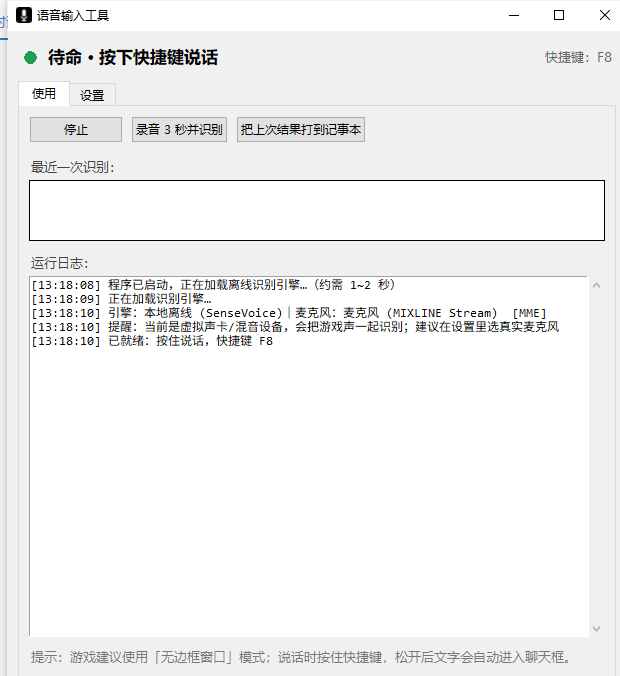

# VoiceInputTool

[](LICENSE)


**Hold a hotkey, speak, release — your speech is typed straight into the game chat.**

Offline speech recognition powered by **SenseVoiceSmall (int8)** on your own machine.
Optional OpenAI-compatible cloud ASR. Text is injected with Windows `SendInput`
(Unicode), so Chinese, English, numbers and symbols work without an IME.

[中文 README](README.md) · [Releases](../../releases) · [Issues](../../issues) · [Changelog](CHANGELOG.md)



## Features

- Push-to-talk or toggle-to-talk
- Global hotkey: F1–F12, letters, mouse side buttons (`mouse4`/`mouse5`), combinations (`ctrl+alt+v`)
- Auto-open game chat and auto-send (each can be disabled)
- Only type when the target game is in the foreground; otherwise copy to clipboard
- Word replacements (`a大=A大`), ITN (numbers/dates), punctuation stripping
- Local SenseVoice or any OpenAI-compatible `/audio/transcriptions` endpoint
- Optional clipboard-only mode (zero key injection)
- Beeps, always-on-top, microphone picker, 3-second recording test
- Chinese / English / Japanese / Korean / Cantonese / auto detection

## Download & install

1. Download the latest installer from [Releases](../../releases).
2. Run it. It installs per-user to `%LOCALAPPDATA%\Programs\VoiceInputTool` — no admin required.
3. Or use the portable zip: unzip, run `语音输入工具.exe`.

> The binaries are not code-signed yet. Windows SmartScreen may warn on first launch;
> choose “More info → Run anyway”.

Data and logs live in `%LOCALAPPDATA%\VoiceInputTool`.

## Quick start

1. Open **Settings**, select your real microphone (not MIXLINE / Stereo Mix).
2. Click **Save & Apply**.
3. In game, hold **F8**, speak, release.

If keys do not reach the game, run the app as administrator.

## Build from source

Windows 10/11 x64, Python 3.10+ (3.12 recommended):

```powershell
git clone https://github.com/XIA1249218726/voice-input-tool.git
cd voice-input-tool
powershell -ExecutionPolicy Bypass -File scripts\setup-dev.ps1
powershell -ExecutionPolicy Bypass -File scripts\run.ps1

# tests
powershell -ExecutionPolicy Bypass -File scripts\test.ps1
```

The 228 MB model is downloaded by `scripts/download-model.ps1` into `models/sense-voice/`
and is not committed.

Package:

```powershell
powershell -ExecutionPolicy Bypass -File build\build_app.ps1
powershell -ExecutionPolicy Bypass -File build\build_installer.ps1
```

See [docs/05-打包与安装.md](docs/05-打包与安装.md) for details.

## Privacy & risk

- Recognition is local by default; audio never leaves the machine.
- Cloud mode is opt-in and sends audio to the endpoint you configure.
- The app does **not** read game memory, inject into processes, or modify game files.
- It only records audio and calls `SendInput`. Third-party key injection may violate
  game terms of service; use at your own risk. Clipboard-only mode avoids injection entirely.

Not affiliated with Riot Games, Valorant, FunASR, SenseVoice or sherpa-onnx.

## Contributing

Read [CONTRIBUTING.md](CONTRIBUTING.md) and [CODE_OF_CONDUCT.md](CODE_OF_CONDUCT.md).
Report security issues privately via [SECURITY.md](SECURITY.md).

## License

MIT for the source code. See [LICENSE](LICENSE) and [THIRD_PARTY_NOTICES.md](THIRD_PARTY_NOTICES.md).
